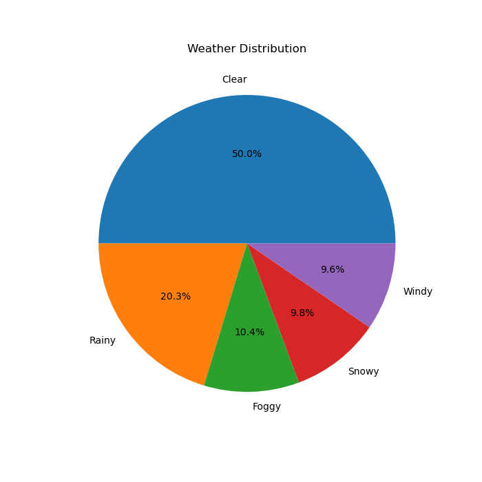
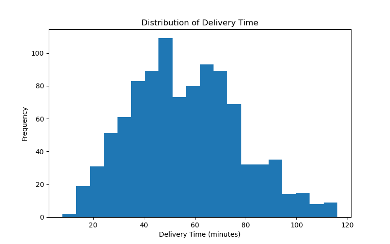
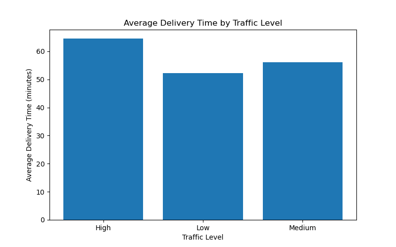
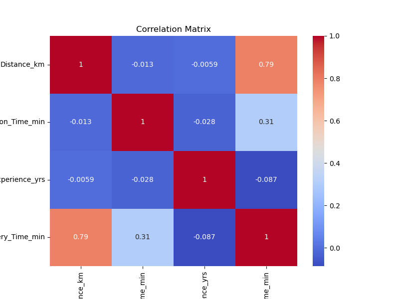
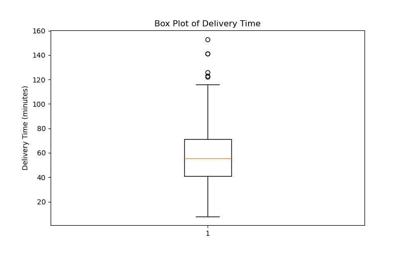
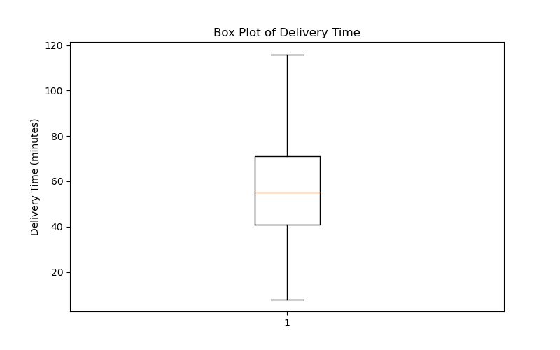

# 🛵 Food Delivery Time Prediction Using Machine Learning

An end-to-end Machine Learning project to predict food delivery time in minutes based on delivery distance, weather conditions, traffic level, preparation time, and courier experience. Developed as part of the **SYBCA-AI (Semester III)** coursework at **Sutex Bank College of Computer Applications & Science**.

---

## 👥 Team Members
- **Dhruv Vora** (Roll No: 551)
- **Shyam Sitapara** (Roll No: 550)
- **Faculty / Supervisor:** Hiral A. Patel

---

## 📊 Project Overview & Dataset
* **Dataset Source:** Kaggle – Food Delivery Time Dataset
* **Target Variable:** `Delivery_Time_min` (Total delivery time in minutes)
* **Features Used:** `Distance_km`, `Weather`, `Traffic_Level`, `Time_of_Day`, `Vehicle_Type`, `Preparation_Time_min`, and `Courier_Experience_yrs`.
* **Data Preprocessing:** Handled missing values (imputed categorical with mode, numerical with median), cleaned outliers using the Interquartile Range (IQR) method, and applied One-Hot Encoding to categorical features.

---

## 📈 Exploratory Data Analysis (EDA) & Visualizations

Here are some key insights discovered during EDA:

| Weather Distribution (Pie Chart) | Delivery Time Distribution (Histogram) |
| :---: | :---: |
|  |  |

| Traffic Level Impact (Bar Chart) | Correlation Matrix (Heatmap) |
| :---: | :---: |
|  |  |

| Outlier Detection (Box Plot Before) | Cleaned Data (Box Plot After) |
| :---: | :---: |
|  |  |

---

## 🤖 Model Performance & Evaluation Results

We trained and evaluated **Linear Regression** and **Ridge Regression** models using an 80:20 train-test split.

### 1. Linear Regression Results
* **MAE (Mean Absolute Error):** 5.5792
* **MSE (Mean Squared Error):** 73.9204
* **RMSE (Root Mean Squared Error):** 8.5977
* **$R^2$ Score:** **0.8508 (85.08%)**
* **Cross-Validation Mean $R^2$:** 0.7895

### 2. Ridge Regression Results
* **MAE:** 5.5773
* **MSE:** 73.8912
* **RMSE:** 8.5960
* **$R^2$ Score:** **0.8508 (85.09%)**

---

## 🚀 How to Run the Project Locally

1. **Clone the Repository & Navigate to Project Folder:**
   ```bash
   git clone https://github.com/your-username/ai-food-delivery-project.git
   cd Food_Delivery_Time_Prediction_550_551
   ```

2. **Install Dependencies:**
   ```bash
   pip install -r requirements.txt
   ```

3. **Run the Python Script:**
   ```bash
   python Python_Code/project.py
   ```

---

## 📂 Project Directory Structure
```text
Food_Delivery_Time_Prediction_550_551/
│
├── .gitignore
├── requirements.txt
├── README.md
│
├── Dataset/
│   └── Food_Delivery_Time_Dataset.csv
│
├── Python_Code/
│   └── project.py
│
├── Reports/
│   ├── Project_Report.pdf
│   └── SWEETVIZ_REPORT.html
│
└── visualizations/
    ├── Bar_Chart.png
    ├── Box_Plot_After.png
    ├── Box_Plot_Before.png
    ├── Heatmap.png
    ├── Histogram.png
    └── Pie_Chart.png
```